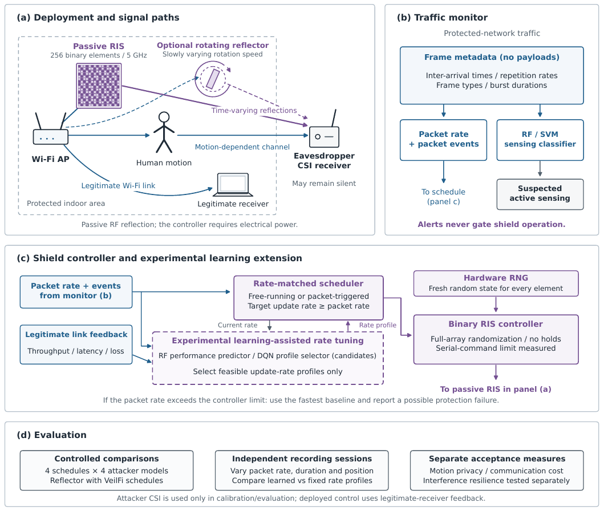

# VeilFi

**Protecting indoor privacy from WiFi motion sensing using a reconfigurable reflecting surface.**

Jeddah International College, Department of CSIT.
Bejad Alotaibi, Abdulaziz Farea, Ahmed Elghamary, Louay Alkilani, Mnar Alnaghes (supervisor).

> **Status:** research proposal / early implementation. No experimental results yet.

## Overview

WiFi Channel State Information (CSI) can reveal human presence and movement even when traffic is encrypted, and a passive eavesdropper transmits nothing that could be detected. VeilFi combines:

1. **Privacy shield.** A passive 256-element RIS near the access point is driven by a *no-hold, full-array, rate-matched random schedule*, so an eavesdropper rarely gets two packets under the same surface configuration. An optional rotating reflector covers packet rates above the controller limit.
2. **Traffic monitor.** A metadata-only monitor measures the protected network's packet rate, which sets the shield's update rate, and flags suspected active sensing. The shield never waits for an alert.
3. **Evaluation.** Four attackers are tested against four shield settings: windowed variance, minimum consecutive change, an ML classifier, and the same classifier retrained on shielded data. Privacy is reported as attacker advantage (TPR − FPR) with session-level confidence intervals, and communication cost is measured in the same runs.



## Repository layout

```
src/veilfi/
  shield/         reconfiguration schedule, RIS serial controller
  monitor/        pcap header reader, traffic-monitor features
  csi/            CSI preprocessing (amplitude normalization, phase sanitization, windows)
  attackers/      threshold attackers (i, ii) and ML attackers (iii, iv)
  eval/           attacker advantage, session bootstrap CIs, session-level splits
configs/          per-session experiment configuration
scripts/          hardware utilities (e.g. measuring the controller update limit)
docs/             ethics checklist and protocol notes
tests/            unit tests (synthetic data only)
```

## Quick start

```bash
python -m venv .venv && source .venv/bin/activate
pip install -e ".[dev]"            # add ,hardware for pyserial/scapy
pytest
```

## Simulation study (simulated, not measured)

`src/veilfi/sim/` contains a CSI channel model (static multipath, a moving person, a 256-element binary RIS, an optional rotating reflector, and noise) used for a preliminary study before the hardware exists. All parameters are assumptions, so results indicate trends only.

```bash
python scripts/run_simulation.py          # about 3 minutes; creates results/sim/results.json
python scripts/make_sim_figures.py        # figures and LaTeX table in results/sim/
```

## Data policy

Raw CSI and pcap files contain participant data and are **never committed** (see `.gitignore`). Only consented, de-identified recordings will be released with the final report. See [`docs/ethics_checklist.md`](docs/ethics_checklist.md).

## Roadmap

- [ ] Build RIS and controller; channel characterization; measure update-rate limit
- [ ] Testbed integration (AP, Nexmon CSI eavesdropper, monitor, legitimate client)
- [ ] Static and hold-based baselines; pilot sessions; fix acceptance criteria
- [ ] VeilFi schedules and rotating reflector; full session collection
- [ ] Deep attacker (CNN-GRU-attention); retraining on shielded data
- [ ] Traffic-monitor dataset and classifier
- [ ] Learning-assisted rate tuning (simulation, then hardware)
- [ ] Final held-out evaluation and release

## Key references

- P. Staat et al., "IRShield: A countermeasure against adversarial physical-layer wireless sensing," IEEE S&P 2022.
- M. Heinrichs, A. Sezgin, R. Kronberger, "Open source reconfigurable intelligent surface for the frequency range of 5 GHz WiFi," ISAP 2023.
- F. Gringoli et al., "Free your CSI: A channel state information extraction platform for modern Wi-Fi chipsets," WiNTECH 2019.

## License

MIT. See [LICENSE](LICENSE).
